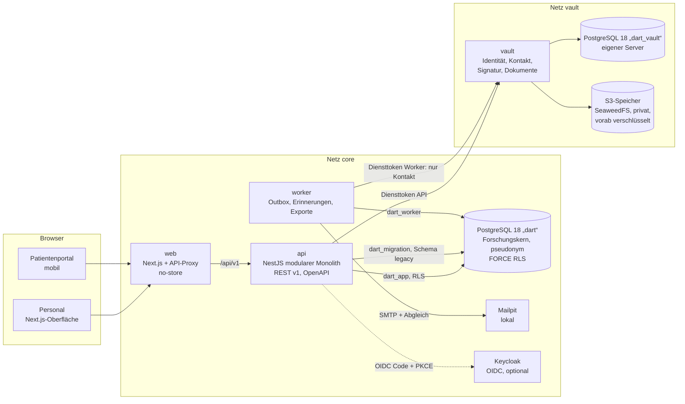
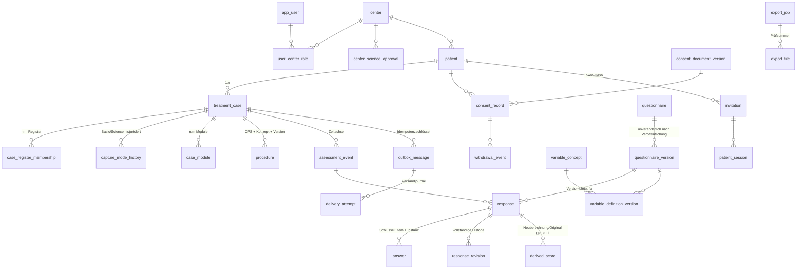

# Architektur und Datenmodell

## Komponenten und Sicherheitsgrenzen

- **Forschungskern** (`dart`): ausschließlich pseudonyme Daten; keine Namen, Kontakte, Signaturen.
- **Vault** (`dart_vault` + S3): eigene Datenbank auf eigenem Server, eigene Schlüssel, eigenes Netzwerk. Der Kern hat keine DB-Rechte darauf.
- **Datenbankrollen:** `dart_owner` (nur Migration/Seed), `dart_app` (API, RLS), `dart_worker` (Versand/Export), `dart_migration` (Schema `legacy`).
- **Outbox:** fachliche Änderung und Versandauftrag in einer Transaktion; der Worker versendet idempotent.
- **Caching:** Alle Antworten `private, no-store`; keine Gesundheitsdaten in URLs (UUIDs und Fallnummern sind keine Gesundheitsdaten; Einladungstoken nur im URL-Fragment).

## Fachmodule der API

| Modul | Datei | Inhalt |
|---|---|---|
| Anmeldung, Stammdaten, Administration | `modules/admin.ts` | Demo-/OIDC-Anmeldung, Katalog, OPS-Suche, Zentren, Konten, Rollen, Audit |
| Patienten/Fälle | `modules/cases.ts` | Dashboard, Aufgaben, Anlage, Detail, Identität (Vault), Klarnamensuche, Datumskorrektur, Moduswechsel |
| Follow-up | `modules/followup.service.ts` | Consent-Gate, Aktivierung, Zeitachse, Outbox-Planung, Sperre bei Widerruf |
| Einwilligung | `modules/consent.ts` | Vorbereitung, Vor-Ort-Einladung, Upload, Sichtprüfung, Widerruf, Signaturadapter |
| Erhebungen | `modules/responses.ts` | Laden, Autosave mit If-Match, Abschluss, Wiederöffnung, Revisionen, Scores |
| Patientenportal | `modules/portal.ts` | Einlösen, Zugangscode, Übersicht, Signatur, Kopie, Widerruf, Befragung, neuer Link |
| Formulare | `modules/forms.ts` | Entwurf, Prüfung, Freigabe, Veröffentlichung, Ruhestand, Export/Import |
| Auswertung/Export | `modules/reports.ts` | Zentrumsbericht, Exportantrag, Genehmigung, Download |
| Migration | `modules/migration.ts` | Probelauf, Import, Rollback, Reconciliation, Quellenmanifest |

## Datenmodell (Kern)

Weitere Tabellen: `audit_event` (append-only), `idempotency_record`, `data_subject_request`, `score_algorithm_version`,
`followup_plan_version`, `assignment_matrix_version`. Schema `legacy`: `source_manifest`, `mapping_rule_version`, `migration_batch`,
`legacy_record` (Rohwert), `legacy_value` (normalisiert, Provenienz), `legacy_key_map`, `reconciliation_issue`.
Vault: `identity` (verschlüsselte Felder, HMAC-Namensindex, Zugangscode-Hash), `document`, `access_log`.

### Zentrale Invarianten (in Datenbank und Code erzwungen)

- `answer`: genau ein Wert **oder** ein zulässiger Fehlgrund (CHECK); Schlüssel = Antwortinstanz + Item + Wiederholungsinstanz.
- `consent_record`: „gültig“ nur mit Nachweis, Hash, Prüfzeit und Unterschriftsdatum (CHECK).
- `treatment_case`: operativ braucht geplantes oder tatsächliches OP-Datum, konservativ einen eigenen Behandlungsbeginn; Patient und Fall im selben Zentrum (Trigger).
- `questionnaire_version`: veröffentlicht/Ruhestand unveränderlich (Trigger), höchstens eine veröffentlichte Version je Formular.
- `outbox_message.idempotency_key`, `legacy_record`-Quellschlüssel, `response (Ereignis, Formularversion)`: UNIQUE.
- `export_job`: Entscheider ≠ Antragsteller (CHECK). Datum ohne Uhrzeit als `DATE`, Zeitstempel `timestamptz` (UTC), Anzeige de-DE/Europe-Berlin.
